# TSAAT inventory v2 relationships

This diagram groups retained relationships. Inventory keys include the snapshot; consult the [generated catalogue](../docs/generated/database-catalogue.md) for exact columns, keys, constraints and routines. Settings and CMDB mappings are configuration rather than observations.

```mermaid
erDiagram
  dataset_snapshot ||--o{ managed_network : contains
  dataset_snapshot ||--o{ ict_system : contains
  dataset_snapshot ||--o{ asset : contains
  managed_network ||--o{ managed_network_hierarchy : hierarchy
  ict_system ||--o{ ict_system_hierarchy : hierarchy
  managed_network ||--o{ network_declared_system : declares
  ict_system ||--o{ network_declared_system : membership
  managed_network ||--o{ asset : owns
  ict_system ||--o{ asset : owns
  managed_network ||--o{ network_declared_asset : declares
  asset ||--o{ network_declared_asset : membership
  ict_system ||--o{ system_environment : contains
  system_environment ||--o{ system_environment_asset : membership
  asset ||--o{ system_environment_asset : membership
  ict_system ||--o{ system_mission_capability : supports
  ict_system ||--o{ system_business_service : supports
  asset ||--o{ ci_dependency : source_or_target
  asset ||--o| asset_operating_system : endpoint_os
  asset ||--o| asset_network_os : network_os
  asset ||--o| asset_patch_state : device_patch_state
  asset ||--o{ asset_installed_software : installation
  asset ||--o{ asset_vulnerability : observation
  discovery_tools_settings_version ||--o{ discovery_tool : revision
  discovery_tool ||--o{ discovery_tool_asset_scope : applicability
  discovery_tool_detection_definition ||--o{ discovery_tool_detection_rule : rules
  discovery_tool_detection_rule ||--o{ discovery_tool_detection_rule_value : values
  cmdb_attribute_definition ||--o{ cmdb_asset_type_attribute : presentation
```

The discovery source catalogue, persona revision table and storage schema marker complete the retained configuration. Directed CI observations, environment/service/capability membership and ARP ownership support Topology. CMDB model-CI mappings are added by migration 032.

Removed structures are enumerated in [retired-storage-v2.json](retired-storage-v2.json). Fresh installation uses the reduced base schema and build manifest additions. Existing installations use SQL 033 and the paired JSON migration with backup and explicit target selection. See [upgrade and recovery](../docs/feature-retirement.md). Historical migrations remain published but must not be replayed on v2.
