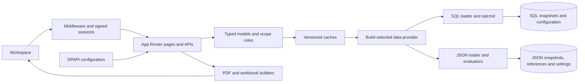

# Architecture

## Runtime boundaries

TSAAT uses Next.js 14 App Router, React 18 and strict TypeScript. Server pages/API handlers compose snapshot-scoped models; client components render interactions, charts, explorer tables and dialogs. Tailwind and app/globals.css implement the shared visual system. Build-time provider selection chooses SQL Server or a persistent JSON file store for runtime data and configurable rules. Feature code uses the same typed data facade in both artifacts.

## Ownership

- `app/`: route composition, request parsing, response contracts and authentication boundaries.
- `components/`: presentation and client interactions. FindingsDataTable/FilterHeader own table controls; WorkspaceTabs owns shared keyboard tab behavior.
- `lib/`: typed domain contracts, scoping, SQL access, caches, reports and authentication helpers.
- `Database Schema/`: schema, ordered migrations, SQL evaluation procedures, reference catalogue and import/validation scripts.
- `tests/`: unit, route, contract and explicitly gated SQL integration checks.

## Scope, time and configuration

The header applies either managed-network or ICT-system selection plus dataDate. Changes stay pending until Update. Navigation carries the applied scope; empty scope produces an empty workspace. Loaders resolve the actual snapshot and drill-through/reports retain it. Network-scoped KPIs resolve systems using infrastructure within selected networks and deduplicate those systems.

Provider-backed KPI/SPI catalogues govern measure definitions, applicability, calculations, outcomes, report bindings and tasking. The app aggregates evaluations and applies configured severity/priority mappings. Settings changes participate in cache signatures. CMDB display mappings are loaded per asset type on request; canonical values remain typed and snapshot-aware.

## Large interactions

Network/ICT analysers use lazy APIs and worker-assisted filtering/rendering. Separate asset actions open CMDB and compliance. The shared compliance view is native-modal, Settings-sized and snapshot-aware. Service Impact has Scope & Selection and Explore the Impact tabs. Shared risk-profile models support entity explorers, details panels, trends and device/SPI heatmaps.

## Compatibility and limits

Retired `/networks`, `/systems` and entity paths redirect to current risk profiles/details, preserving scope/date. Existing report/export/API paths and internal compatibility contracts remain. Removed sidebar pages are not restored. [Generated routes](generated/application-inventory.md) distinguish available routes from visible navigation.

Windows DPAPI/PowerShell remain runtime/setup dependencies for both builds. Only SQL requires sqlcmd and DB_config. Linux-only deployment is not claimed. Production cookies require HTTPS. Identity-provider, SQL-driver, framework-major or storage-model changes need an ADR and parity/migration plan.

Unreachable legacy presentation modules are removed rather than maintained beside their replacements. Repository checks trace all routes, scripts and worker dependencies; TypeScript rejects unused private declarations. Compatibility roots remain supported. KPI SQL evaluates only the two current system metrics, retaining high-priority finding counts without executing retired SPI/discovery KPI calculations. See [ADR 0004](adr/0004-retired-runtime-cleanup.md).

## Storage provider boundary

The shared lib/data-loader.ts facade selects lib/sql-data-loader.ts or lib/json-store/data-loader.ts using a compiled constant. The CMDB facade does the same for per-type attributes. All pages/APIs/reports use these facades. The JSON provider satisfies the SQL operation types, evaluates registered rules on the server and persists settings using atomic file replacement and an exclusive writer lock. Separate output directories allow both builds to coexist.

Settings replaces only Database Settings with JSON Data Files in No-SQL. Authentication/password handling and all other settings remain shared. SQL execution is explicitly blocked in No-SQL. Reference/snapshot revisions and settings timestamps participate in cache invalidation. Persisted finding history is required for imported JSON snapshots; no historical events are fabricated.

See [data providers](data-providers.md) and [ADR 0006](adr/0006-dual-data-provider-builds.md). This replaces the removed static demo and its browser adapters.
