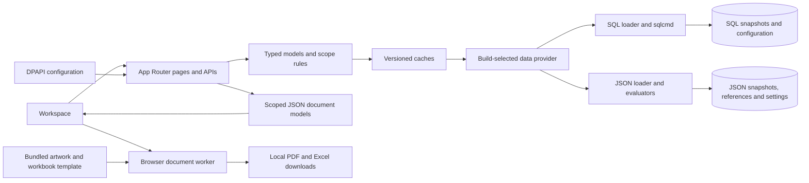

# Architecture

Endpoint/vulnerability Insight report APIs validate header scope/domains/date and reuse the page's overview plus snapshot-pinned facade projection. They return JSON document models; the browser worker renders vector PDFs through the existing report layout helper. Download requests contain only header scope and resolved date; errors are sanitized and responses are not cached. Both providers share this presentation path. See [report contracts](inventory-insights-reports.md).

Security Vulnerability Insights composes the existing Discovery Insights measures with the vulnerability Explorer facade at the resolved snapshot. Its charts and missing-value cards use the same shared table facets as Security Vulnerability Explorer, without changing provider operations or rules. The new Governance ID preserves saved persona page lists. See [the feature contract](../Requirements%20Documentation/23-Security-Vulnerability-Insights.md).

End Point Insights reuses the Discovery Insights loader/model and the endpoint facade at its resolved snapshot. It presents existing Explorer facet counts without adding provider queries or calculations. Its new Governance navigation ID follows existing persona defaults and preserves saved page selections. See [the feature contract](../Requirements%20Documentation/22-End-Point-Insights.md).

Discovery Insights moves the existing discovery overview model into a Governance briefing at `/governance/discovery-insights`; its old URL redirects before reading evidence. The stable `discovery-overview` persona ID is preserved in the Governance group. No stored settings, providers or calculations change.

Model CI CMDB support keeps Business Service/Mission Capability identity in their existing snapshot association sources. `lib/cmdb-ci-types.ts` declares their CMDB classes; `lib/cmdb-model-ci.ts` resolves type/ID and scoped associations through common selectors. The existing CMDB API dispatches optional model types and uses the same attribute-loader facade and modal provider. SQL migration 032 and an explicit JSON reference upgrade extend configurable fields together. See [ADR 0021](adr/0021-model-ci-cmdb.md).

TopologyGraph owns transient layout, camera, moved-node, inspection and search state above the inline/modal rendering boundary. The same TopologyDiagram renders either inline or in a native dialog portal; toggling full screen retains that state without duplicating the graph or changing provider/scoping logic. Header mode tabs reset the diagram's view while retaining the graph shell and its full-screen state. The modal restores body scrolling and toggle focus on exit.

`components/impact-graph-node-visual.tsx` supplies the shared SVG node presentation and sizing for Service Impact and Topology Explorer. Shared `impact-graph-*` CSS keeps their graph surfaces consistent, with container-responsive inline sizing for Topology. Each feature retains its own model, evidence/count meaning, tracing and interactions; the presentation primitive performs no provider reads or scope filtering.

Topology Explorer loads the resolved full snapshot through `lib/data-loader.ts` and builds lookup/model paths plus a separate domain-filtered dependency context pool in `lib/topology-explorer.ts`. Business Impact traces model descendants and their ancestors. Dependencies traces only direct Flow Dependency peers of the starting endpoint or header-scoped model members, then attaches their model ancestry. Lookup remains header-scoped; explicit peer exploration changes the header to the peer network/associated systems. The client reuses Impact Topology layouts, WorkspaceTabs and FindingsDataTable; no provider query, schema, persisted setting or package changes. See [Topology Explorer](../Requirements%20Documentation/20-Topology-Explorer.md) and [ADR 0020](adr/0020-topology-modes-and-context.md).

`/measures/trends` loads bounded summary history through `lib/measures-trends-data.ts`, reusing current measure definitions, analytics and provider KPI evaluation. `lib/measures-trends.ts` produces the same aggregate model for SQL and JSON; raw historical inventories stay on the server. The client component provides period/tab/indicator navigation, date-spaced SVG charts and CSV evidence without a new API, stored structure or dependency. See the [feature contract](../Requirements%20Documentation/19-Measures-Trends.md).

Installed Software Insights is a standalone Governance briefing; the compact Installed Software Dashboard remains available at its existing Discovery URL for bookmarks, without a sidebar link. Both render a small server-built summary without tabs. The server consumes the existing `loadInstalledSoftwareExplorerData` facade and `buildInstalledSoftwareInsights` projects those same scoped installation rows. It adds no provider operation, query, persistence or external chart assets. Evidence links use the shared Explorer filter contract and persona-aware navigation; the resolved snapshot travels with each link. See [the feature contract](../Requirements%20Documentation/18-Installed-Software-Insights.md).

Life Cycle Management uses the existing full-snapshot data facade and one pure scoped projection for hardware/software/OS evidence and server priorities. Full loading is required because SQL summary loads omit software. It changes no SPI evaluation, provider query, storage or cache. See the [feature contract](../Requirements%20Documentation/16-Life-Cycle-Management.md).

PersonaProvider shares browser-local active selection and server-loaded settings across Settings, the read-only header persona label, WorkspaceShell, PersonaLink and popup controls. Stable navigation page IDs map scoped/filter URLs and compatibility aliases to a single preference check. Section and page gates filter the sidebar; PersonaLink removes href/actions from unavailable destinations, and popup buttons plus render/action guards enforce independent popup choices. Routes, APIs and report downloads retain their existing login-free access. The data facade stores complete JSON revisions in SQL `persona_settings_version` (migration 031) or optional JSON `settings/personas.json`. Payload version 3 stores dynamic persona IDs, labels, order and permissions. Version 1/2 upgrades in memory; explicit saves compare the source revision before publishing, returning 409 for stale editors. The selector/header use stored labels and removed active IDs reset to no persona. Both fresh setups consume the same bootstrap JSON. No read/build rewrite or calculation cache change occurs. See [Personas](personas.md) and [ADR 0015](adr/0015-persona-navigation-preferences.md).

Discovery Insights and the patch/vulnerability explorers omit repeated demo-data notices. This is a shared presentation-only change; source records, provenance fields, aggregations and export/provider operations remain unchanged.

## Runtime boundaries

TSAAT uses Next.js 14 App Router, React 18 and strict TypeScript. Server pages/API handlers compose snapshot-scoped models; client components render interactions, charts, explorer tables and dialogs. Tailwind and app/globals.css implement the shared visual system. Build-time provider selection chooses SQL Server or a persistent JSON file store for runtime data and configurable rules. Feature code uses the same typed data facade in both artifacts.

## Document generation boundary

All PDF and Excel construction runs in the browser through `lib/documents/document.worker.ts`. The application server retains report-model preparation, configured measure/history evaluation, canonical row selection and existing scope/date validation. It returns versioned JSON envelopes rather than document bytes. `lib/documents/server-response.ts` preserves read-only GET URLs: HTML navigation redirects to `/documents/generate` with the original source query, while JSON requests receive a no-store envelope. The summary API keeps its existing default JSON response; `format=pdf` selects its document model. Existing CSV contracts remain unchanged.

The shared client controller streams bounded document data, starts one worker job, relays real progress and downloads a local Blob. Cancellation aborts the read and terminates the worker; errors never download partial documents. PDF renderers use pinned pdf-lib and local artwork. Workbook helpers use browser byte arrays and local ZIP/XML assembly; the target-state template is a static bundled asset. Server routes import renderer types only, and the worker must not reach providers, Node filesystem/SQL modules or server-only loaders. Dependency-boundary regression tests enforce both directions.

The existing SQL/JSON application server remains necessary for data and settings. This change adds no provider, identity boundary or browser storage copy; persona preferences remain presentation controls under the existing application access model. See [ADR 0024](adr/0024-browser-document-generation.md) and the [audit and runtime contract](client-document-generation.md).

## Ownership

- `app/`: route composition, request parsing, response contracts and input validation.
- `components/`: presentation and client interactions. FindingsDataTable/FilterHeader own table controls; WorkspaceTabs owns shared keyboard tab behavior.
- `lib/`: typed domain contracts, scoping, SQL access, caches, reports and compatibility helpers.
- `Database Schema/`: schema, ordered migrations, SQL evaluation procedures, reference catalogue and import/validation scripts.
- `tests/`: unit, route, contract and explicitly gated SQL integration checks.

## Scope, time and configuration

The header applies either managed-network or ICT-system selection plus dataDate. Changes stay pending until Update. Navigation carries the applied scope; empty scope produces an empty workspace. Loaders resolve the actual snapshot and drill-through/reports retain it. Network-scoped KPIs resolve systems using infrastructure within selected networks and deduplicate those systems.

Provider-backed KPI/SPI catalogues govern measure definitions, applicability, calculations, outcomes, report bindings and tasking. The app aggregates evaluations and applies configured severity/priority mappings. Settings changes participate in cache signatures. CMDB display mappings are loaded per asset type on request; canonical values remain typed and snapshot-aware.

## Large interactions

Network/ICT analysers use lazy APIs and worker-assisted filtering/rendering. Separate asset actions open CMDB and compliance. The shared compliance view is native-modal, Settings-sized and snapshot-aware. Service Impact keeps Scope & Selection on the page and opens a Settings-sized graph dialog from Explore selection. Its presentation adapter (lib/service-impact-graph.ts) projects the already scoped shared model into typed nodes and recorded edges without new provider operations, persistence or risk calculations. A bounded deterministic SVG layout supports interactive exploration, complete-scope search and existing finding details. Shared risk-profile models support entity explorers, details panels, trends and device/SPI heatmaps.

The Service Impact adapter also performs display-only severity/count filtering and deduplicated filtered summaries over existing finding rows. It supplies force, directional hierarchy, circular/radial and custom-coordinate layouts. Coordinates are generated once from the full scoped graph and held in client state so filtering does not relocate spatial nodes; edits are never persisted. use-impact-graph-layout.ts owns a cancellable animation frame loop for position interpolation and respects reduced motion. Nodes, edges and camera bounds share the interpolated positions. The SQL/JSON loaders, severity definitions, calculation contract and schemas are unchanged; no network assets or additional packages are introduced.

serviceImpactRiskView derives range limits and displayed nodes from one selected-severity projection before applying the inclusive count range. The graph, exact count badges, node breakdown and finding detail rows share that projection. This is client presentation filtering over the existing model, with no provider or stored calculation changes.

Network Impact Analyser is retired from the shared UI. Its former page redirects before data loading to the scope-appropriate risk profile. Shared analyser APIs and canonical CMDB networkId response metadata remain compatible; lib/network-impact-navigation.ts now retains only the exact-ID API filter, with no UI link builders or preset resolution. ICT impact/dependencies and provider facades retain their existing behavior.

## Compatibility and limits

Retired `/networks`, `/systems` and entity paths redirect to current risk profiles/details, preserving scope/date. Existing report/export/API paths and internal compatibility contracts remain. Removed sidebar pages are not restored. [Generated routes](generated/application-inventory.md) distinguish available routes from visible navigation.

Application pages and APIs open directly without login/session middleware or a client session guard. Signed in, Logout, Password Settings and credential provisioning are retired. Legacy login bookmarks redirect to validated local destinations; credential/password APIs return 410 and the session endpoint reports authenticationRequired=false without creating an identity. See [ADR 0014](adr/0014-retire-application-login.md).

SQL retains Windows DPAPI/PowerShell for encrypted DB_config and sqlcmd. The explicit setup command uses a separate administrator connection to prepare the application database and dedicated SQL login, with SSL disabled, and validates app credentials before publishing configuration. An existing target is dropped and rebuilt after target-specific acknowledgement; verified login identity is retained across replacement. Database deletion/rebuild is not transactional; account grants are transactional and provide database read/write/execute access without server roles. Runtime passwords use the child process environment, and Windows fallback requires explicit opt-in. Database Settings hides transport-policy controls, retains the saved values and folds required encryption validation into Test Connection. Configuration-only tools and compatibility APIs retain explicit TLS support. Builds never provision SQL. See [ADR 0017](adr/0017-dedicated-database-login.md) and [ADR 0018](adr/0018-replace-database-during-setup.md). No-SQL no longer needs application-login DPAPI operations. Linux-only deployment is not claimed. Identity-provider, SQL-driver, framework-major or storage-model changes need an ADR and parity/migration plan.

Unreachable legacy presentation modules are removed rather than maintained beside their replacements. Repository checks trace all routes, scripts and worker dependencies; TypeScript rejects unused private declarations. Compatibility roots remain supported. KPI SQL evaluates only the two current system metrics, retaining high-priority finding counts without executing retired SPI/discovery KPI calculations. See [ADR 0004](adr/0004-retired-runtime-cleanup.md).

## Storage provider boundary

Governance Overview is retired; its route redirects to Trends with query selections preserved. The unused placeholder component is removed. Trends loads full-profile history through the existing month-window facade and filters it to the requested week or calendar month ending on the header date, projects existing SPI results/lifecycle rules/discovery mappings into serializable metrics, and renders an executive infographic with scoped persona-aware evidence links and CSV export. See [Governance Trends](../Requirements%20Documentation/17-Governance-Trends.md). Insights uses a server-rendered briefing and the normal route-ready marker. `loadGovernanceInsights` composes the existing Discovery Insights loader and full-profile core data/Service Impact model, pins both to one resolved snapshot, and forwards only header scope/domain/date. A pure presentation projection deduplicates findings, ranks existing service rows and selects nonzero editorial action prompts. No new provider implementation, persisted score or schema is introduced. Both builds use the same component, local SVG/branding and scoped evidence links; failures produce a retry state rather than zero metrics.

The Insights masthead loads `GET /api/governance/insights/report` through the shared document controller. The Node route validates header context and calls the same Insights loader, returning only the report projection. In the browser worker, `governance-insights-pdf.ts` renders a paginated A4 infographic using existing pdf-lib, embedded standard fonts and bundled artwork. The loader exposes the existing core dataset `generatedAt` as `snapshotGeneratedAt`. The PDF distinguishes that recorded snapshot timestamp from its export generation time and retains scope/date context. JSON report data is no-store; PDF bytes are downloaded locally. No underlying provider query or storage format changes.

Discovery Insights composes the existing coverage, endpoint, software, Shadow IT, vulnerability and patch facade operations at the same resolved snapshot. Its pure aggregation counts canonical explorer rows; patch status and overdue calculations remain in the shared patch projector. Scope/date drill-through links use discoveryExplorerHref and validated destination filters, with patch posture accepting the same initial-filter contract as the other explorers. No new provider query implementation, store, schema, external service or cached summary table is introduced.

Server patch observations are optional typed evidence on the existing Dataset, stored in SQL's snapshot-keyed server_patch_observation table or JSON's server patchManagement object. Shared facade operations load a full cached snapshot and use one scope/status projection for both providers. The export reuses the same projection and selected table-view filtering. This does not alter network-device patch rules or configurable measures. See [ADR 0011](adr/0011-server-patch-observations.md).

Patch and vulnerability explorers opt into FindingsDataTable's SummaryChart presentation using its existing facet computation and filter state. Chart selections are ordinary column filters, so pagination, per-patch-view persistence and canonical exports remain consistent without another dataset or filter engine. Scoped inventory CSS matches End Point Explorer's panel sizing while retaining the existing table layout for other consumers. This presentation change adds no provider queries, dependencies, schema or calculation changes.

Security Vulnerability Explorer uses a dedicated snapshot-scoped operation on the existing facade. SQL joins vulnerability, endpoint and OS rows on snapshot/asset keys; JSON projects the same persisted observation fields. Shared table filtering is reapplied by the server export. Optional additive metadata and explicit sourced sample population follow [ADR 0010](adr/0010-security-vulnerability-explorer.md).

The shared lib/data-loader.ts facade selects lib/sql-data-loader.ts or lib/json-store/data-loader.ts using a compiled constant. The CMDB facade does the same for per-type attributes. All pages/APIs/reports use these facades. The JSON provider satisfies the SQL operation types, evaluates registered rules on the server and persists settings using atomic file replacement and an exclusive writer lock. Separate output directories allow both builds to coexist.

Settings replaces only Database Settings with JSON Data Files in No-SQL. Application login/password settings are retired; all remaining settings are shared. SQL execution is explicitly blocked in No-SQL. Reference/snapshot revisions and settings timestamps participate in cache invalidation. Persisted finding history is required for imported JSON snapshots; no historical events are fabricated.

Data population is an explicit maintenance operation. SQL table exports are converted into the shared Dataset shape, preserving IDs, dates, inventory details, scope and persisted findings. Missing demonstration attributes are enriched before validated snapshot revisions are published through one manifest replacement; source provenance and a full pre-import backup support recovery. Existing reference/settings files remain authoritative. JSON Shadow IT system scope includes the ARP owner, matching the SQL predicate. See [ADR 0008](adr/0008-explicit-nosql-data-population.md).

See [data providers](data-providers.md) and [ADR 0006](adr/0006-dual-data-provider-builds.md). This replaces the removed static demo and its browser adapters.

## Offline build boundary

The shared launcher resolves the installed Next.js CLI before initializing JSON storage or configuring a build. A missing CLI exits with an offline installation instruction for both providers; dependency installation stays explicit and precedes runtime/build side effects. The dependency-free `install:offline` preflight verifies archives, stops only identified checkout app servers/descendants and invokes guarded npm ci. An install lock prevents overlapping managed installations and blocks new launcher dev/start/build calls. Bare npm ci has no pre-removal project hook; [ADR 0025](adr/0025-offline-install-preflight.md) records the explicit wrapper boundary.

All application and compiler dependency archives live in vendor/npm, with local file resolutions in package-lock.json and original registry URLs/SHA-512 values in a provenance manifest. Node/npm and Windows/PowerShell are preinstalled host tools. npm lifecycle scripts are disabled; current native tools load their packaged platform binaries. Both build commands verify the archive closure, disable telemetry and preload a network-denial guard into Next and inherited Node children/workers. A shared attempt log makes even caught network attempts fail the build. Runtime start/dev keep normal provider networking. CI adds an outbound firewall rule for Node during installation, checks and compilation, using a new empty cache. See [ADR 0007](adr/0007-offline-compilation.md) and the [build contract](offline-builds.md).

The pure SPI evaluator in lib/spi-evaluation.ts is shared by the JSON server and the explicit sample maintenance command. The command reads existing reference/settings files under the store writer lock and uses the existing snapshot publication boundary. It never synthesizes findings in a page request or build. Original history remains immutable; appended sample observations carry provenance and are checked against current applicable evaluations. SQL classification and settings precedence are retained without changing SQL procedures or JSON applicability. See [ADR 0009](adr/0009-explicit-sample-finding-coverage.md).

Risk-profile explorer drill-throughs share the RiskProfile component and existing riskProfileHref scope/date serializer. Native new-tab anchors narrow the destination to the selected row and retain any intersecting applied scope, resolved snapshot, and destination filter. Entity names reuse the existing networkDetails/systemDetails query contract; no new route, storage operation or data dependency is introduced.

Security domains use lib/security-domain.mjs across selectors, SQL query/cache scope and JSON read compatibility. Each entity retains its own required canonical domain. Header scope is propagated through navigation and exports; NONE explicitly returns no entities. See [security-domain decision](adr/0012-security-domain-scope.md).

Discovery Insights and its PDF share lib/discovery-overview-data.ts for snapshot resolution and facade reads. The pure overview model, suggested actions and calculation notes are shared; lib/discovery-overview-report-pdf.ts renders vector charts and paginated tables with existing pdf-lib. No provider-specific query or calculation is added. See [report design](discovery-overview-report.md).
